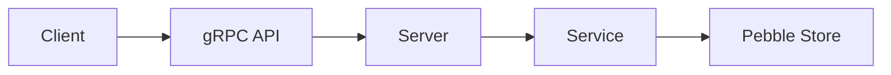

# MakaluKV Design

## 1. Overview

**MakaluKV** is a distributed key-value store written in Go, using a custom implementation of the [Raft consensus algorithm](https://raft.github.io/raft.pdf) to provide replication and fault tolerance across nodes. Nodes communicate with each other using gRPC-based RPCs, while Raft defines the protocol and rules governing that communication.

**MakaluKV** exposes a client-facing API that allows clients to send `GET`, `PUT`, `DELETE`, and `CompareAndSwap` requests to the cluster.

Internally, the system is divided into four main components:

- **Raft core** - contains the protocol logic of the Raft consensus algorithm.

- **Raft runtime** - owns the Raft core and handles concurrency, timers, networking, persistence coordination, and communication with the rest of the system.

- **Raft stable storage** - stores the persistent Raft state of a node, including `CurrentTerm`, `VotedFor`, and eventually the Raft log.

- **State machine** - stores the replicated key-value state and is updated only by committed Raft log entries.

Both the Raft stable storage and the state machine use **Pebble** as their underlying storage engine.

## 2. Current Architecture

## 4. Package Responsibilities

| Package | Responsibility |
|---|---|
| `internal/raft` | Contains the deterministic Raft protocol logic and Raft domain types. It should not depend on gRPC, real timers, goroutines, channels, or Pebble. |
| `internal/storage/raftstore` | Implements durable storage for Raft persistent state using Pebble. Currently stores `HardState`; later it will also store the Raft log. |
| `internal/storage/statemachine` | Stores the replicated key-value state. Provides the storage operations used by the state-machine applier. |
| `internal/service` | Contains client-facing application logic. Currently talks directly to the state machine; later mutations will be routed through Raft. |
| `internal/server` | Contains gRPC server/adapters and translates between Protobuf messages and internal application types. |
| `api/makalukv/v1` | Contains the public Protobuf/gRPC API and generated Go code. |
| `cmd/makalukv-server` | Application entry point. Wires configuration, storage, services, servers, and lifecycle management together. |
| `tests/integration` | Contains integration tests that exercise multiple layers together. |

## 5. Storage Model

### 5.1 Raft Stable Storage
### 5.2 State Machine Storage
### 5.3 Disk Layout

## 6. Raft Core

## 7. Raft Runtime

## 8. Persistence and Crash-Safety Rules

## 9. Leader Election

## 10. Log Replication

## 11. State Machine Application

## 12. Client Request Flow

## 13. Failure and Recovery Model

## 14. Important Invariants

## 15. Design Decisions

## 16. Open Questions
