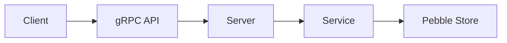

# MakaluKV Design

## 1. Overview

**MakaluKV** is a distributed key-value store written in Go, using a custom implementation of the [Raft consensus algorithm](https://raft.github.io/raft.pdf) to provide replication and fault tolerance across nodes. Nodes communicate with each other using gRPC-based RPCs, while Raft defines the protocol and rules governing that communication.

**MakaluKV** exposes a client-facing API that allows clients to send `GET`, `PUT`, `DELETE`, and `CompareAndSwap` requests to the cluster.

Internally, the system is divided into four main components:

- **Raft core** - contains the protocol logic of the Raft consensus algorithm and coordinates persietence of the Raft state through an instance of `StableStorage`.

- **Raft runtime** - owns the Raft core and handles concurrency, timers, networking, and communication with the rest of the system.

- **Raft stable storage** - stores the persistent Raft state of a node, including `CurrentTerm`, `VotedFor`, and eventually the Raft log.

- **State machine** - stores the replicated key-value state and is updated only by committed Raft log entries.

Both the Raft stable storage and the state machine use **Pebble** as their underlying storage engine.

## 2. Current Architecture

## 4. Package Responsibilities

| Package | Responsibility |
|---|---|
| `internal/raft` | Contains the deterministic Raft protocol logic and Raft domain types. It should not depend on gRPC, real timers, goroutines, channels, or Pebble. |
| `internal/storage/raftstore` | Implements durable storage for Raft persistent state using Pebble. Currently stores `HardState`; later it will also store the Raft log. |
| `internal/storage/statemachine` | Stores the replicated key-value state. Provides the storage operations used by the state-machine applier. |
| `internal/service` | Contains client-facing application logic. Currently talks directly to the state machine; later mutations will be routed through Raft. |
| `internal/server` | Contains gRPC server/adapters and translates between Protobuf messages and internal application types. |
| `api/makalukv/v1` | Contains the public Protobuf/gRPC API and generated Go code. |
| `cmd/makalukv-server` | Application entry point. Wires configuration, storage, services, servers, and lifecycle management together. |
| `tests/integration` | Contains integration tests that exercise multiple layers together. |

## 5. Storage Model
MakaluKV separates persistent Raft state from the replicated key-value state.

Each node maintains two logically separate persistent stores:

- **Raft stable storage** stores safety-critical consensus state such as the current term, the node voted for in that term, and the replicated Raft log.
- **State-machine storage** stores the key-value data produced by applying committed Raft log entries.

This separation keeps consensus metadata and the replicated application state independent. The Raft core interacts with persistent Raft state only through the `StableStorage` abstraction, while the concrete implementation currently uses Pebble.

The storage layer is responsible for durable and atomic persistence operations, but it does not implement Raft protocol decisions. For example, the Raft core determines when a log conflict exists and which suffix must be replaced; stable storage only guarantees that the requested replacement is performed atomically and durably.

### 5.1 Raft Stable Storage

Raft stable storage contains the persistent state required by the Raft protocol.

The current implementation is `PebbleStore`, which uses a Pebble database and
implements the `StableStorage` interface used by the Raft core.

The stored state consists of:

- `currentTerm`;
- `votedFor`;
- the Raft log.

All safety-critical writes are committed synchronously using `pebble.Sync`.

### `PebbleStore`

```go
type PebbleStore struct {
    db *pebble.DB
}
```

`PebbleStore` owns access to the Pebble database containing the persistent Raft
state of a single node.

#### `OpenPebbleStore`

```go
func OpenPebbleStore(path string) (*PebbleStore, error)
```

Opens the Raft Pebble database at the supplied path.

When a new database is opened, `currentTerm` and `votedFor` are initialized
atomically to their zero values if neither exists.

If only one of the two values exists, the hard state is considered inconsistent
and opening the store fails.

#### `Close`

```go
func (s *PebbleStore) Close() error
```

Closes the underlying Pebble database.

### Hard State

The persistent election state is represented by:

```go
type HardState struct {
    CurrentTerm Term
    VotedFor    NodeID
}
```

`CurrentTerm` is encoded as an 8-byte big-endian unsigned integer.

`VotedFor` is encoded directly as the byte representation of the `NodeID`. An
empty value represents that the node has not voted in the current term.

#### `LoadHardState`

```go
func (s *PebbleStore) LoadHardState() (HardState, error)
```

Loads `currentTerm` and `votedFor` from Pebble and reconstructs the persisted
`HardState`.

The stored term must contain exactly 8 bytes. An invalid encoding causes the
operation to fail.

#### `SaveHardState`

```go
func (s *PebbleStore) SaveHardState(hardState HardState) error
```

Persists `currentTerm` and `votedFor`.

Both values are written in the same Pebble batch and committed using
`pebble.Sync`, so the hard state is updated atomically and durably.

### Raft Log

Each persisted Raft log entry contains:

```go
type LogEntry struct {
    Index LogIndex
    Term  Term
    Data  []byte
}
```

The index is encoded in the Pebble key, while the term and entry data are stored
in the value.

The key format is:

```text
"log/" | 8-byte big-endian log index
```

The log index uses a fixed-width big-endian encoding so that Pebble's
lexicographic key ordering also preserves the numeric ordering of Raft log
indexes.

The value format is:

```text
8-byte big-endian term | entry data
```

The first 8 bytes contain the entry's term. All remaining bytes are treated as
opaque `Data`.

The storage layer does not interpret the contents of `Data`; their meaning
belongs to the application/state-machine layer.

Log index `0` represents the conceptual position before the first real log
entry and is not stored as a normal Raft log entry.

#### `LastLogInfo`

```go
func (s *PebbleStore) LastLogInfo() (LogIndex, Term, error)
```

Returns the index and term of the last stored log entry.

Because encoded log keys preserve index ordering, the implementation finds the
last entry by positioning a Pebble iterator at the end of the log key range.

If the log is empty, `(0, 0)` is returned.

The last log index is derived from the stored log rather than persisted as
separate metadata.

#### `LogEntry`

```go
func (s *PebbleStore) LogEntry(
    index LogIndex,
) (LogEntry, bool, error)
```

Returns the log entry at the supplied index.

The boolean indicates whether an entry exists at that index. A missing entry is
therefore distinguished from a storage failure.

The index is reconstructed from the key, while the term and data are decoded
from the stored value.

#### `LogEntries`

```go
func (s *PebbleStore) LogEntries(
    from LogIndex,
    to LogIndex,
) ([]LogEntry, error)
```

Returns log entries in the half-open range:

```text
[from, to)
```

If `to == 0`, all entries from `from` through the end of the log are returned.

The range maps directly to Pebble iterator bounds, and entries are returned in
increasing log-index order.

A range where `from > to` is rejected when `to` is non-zero.

#### `ReplaceLogSuffix`

```go
func (s *PebbleStore) ReplaceLogSuffix(
    from LogIndex,
    logs []LogEntry,
) error
```

Replaces the stored log suffix beginning at `from`.

All existing entries with indexes greater than or equal to `from` are removed
and replaced by the supplied entries.

The replacement entries must form a contiguous sequence beginning at `from`.

The deletion and all replacement writes are executed in a single Pebble batch
and committed using `pebble.Sync`, so suffix replacement is atomic and durable.

An empty `logs` slice truncates the log from `from` onward.

The storage layer does not determine when a suffix should be replaced. Log
conflict detection is Raft protocol logic and remains the responsibility of the
Raft core. `ReplaceLogSuffix` only provides the durable operation used to carry
out that decision.

### 5.2 State Machine Storage
### 5.3 Disk Layout

## 6. Raft Core

The Raft core contains the protocol state and logic required to implement the
Raft consensus algorithm.

Its main responsibilities are:

- leader election;
- log replication;
- tracking committed log entries;
- processing Raft protocol messages;
- maintaining the persistent and volatile state required by Raft.

The core does not perform networking or manage timers. Those responsibilities
belong to the Raft runtime.

The core depends on the `StableStorage` interface so that safety-critical Raft
state can be persisted before protocol actions that depend on it are completed.

### `RaftCore`

`RaftCore` represents the Raft state of a single cluster member.

| Field | Type | Responsibility |
|---|---|---|
| `nodeID` | `NodeID` | Stable identifier of the current node. |
| `role` | `RaftRole` | Current role: follower, candidate, or leader. |
| `storage` | `StableStorage` | Durable storage used for persistent Raft state. |
| `currentTerm` | `Term` | In-memory copy of the current Raft term. |
| `votedFor` | `NodeID` | Node voted for in the current term, or empty if no vote has been cast. |
| `commitIndex` | `LogIndex` | Highest log index known to be committed. |
| `lastApplied` | `LogIndex` | Highest committed log index that has been applied to the state machine. |
| `votesReceived` | `map[NodeID]struct{}` | Set of unique nodes that granted a vote during the current election. |
| `members` | `[]NodeID` | IDs of all members of the Raft cluster, including the current node. |

### 6.1 Construction

#### `NewRaftCore`

```go
func NewRaftCore(config Config, storage StableStorage) (*RaftCore, error)
```

Creates a new Raft core using the supplied cluster configuration and stable
storage.

The constructor validates the configuration, loads the persisted `HardState`,
and initializes the node as a follower.

Persistent state loaded during initialization:

- `currentTerm`
- `votedFor`

Volatile state is initialized in memory.

### 6.2 Leader Election

#### `StartElection`

```go
func (core *RaftCore) StartElection() (RequestVote, RoleTransition, error)
```

Starts a new election.

The node:

1. increments its current term;
2. votes for itself;
3. persists the new `HardState`;
4. becomes a candidate;
5. records its own vote;
6. creates a `RequestVote` message for the current term.

If the node already has a majority after voting for itself, such as in a
single-node cluster, it immediately becomes leader.

The runtime is responsible for delivering the returned `RequestVote` message
to the other cluster members.

#### `HandleVoteRequest`

```go
func (core *RaftCore) HandleVoteRequest(
    req RequestVote,
) (RequestVoteResponse, error)
```

Processes a `RequestVote` received from another cluster member.

The node first validates the sender and compares the request term with its
current term.

A vote may be granted only when:

- the candidate belongs to the cluster;
- the candidate is not the current node;
- the request term is not stale;
- the node has not voted for another candidate in the same term;
- the candidate's log is at least as up-to-date as the local log.

Log freshness is determined by comparing the term of the last log entry first.
If the terms are equal, the log with the greater last index is considered more
up-to-date.

If a higher-term request is received, the node adopts the higher term and
becomes a follower even if the candidate's log is too stale to receive the
vote.

Any change to `currentTerm` or `votedFor` is persisted before the corresponding
Raft state transition is considered successful.

#### `HandleRequestVoteResponse`

```go
func (core *RaftCore) HandleRequestVoteResponse(
    resp RequestVoteResponse,
) error
```

Processes a response to a previously issued `RequestVote`.

Lower-term or invalid responses are ignored.

If the response contains a higher term, the node adopts that term and becomes
a follower.

If the node is still a candidate and the response grants a vote, the responder
is added to `votesReceived`. Because votes are stored by `NodeID`, duplicate
responses from the same node cannot be counted more than once.

Once the number of received votes reaches a majority of cluster members, the
candidate becomes leader.

### Role Transition Helper

#### `becomeFollower`

```go
func (core *RaftCore) becomeFollower(
    term Term,
    votedFor NodeID,
) error
```

Transitions the node into follower state and persists the supplied hard state.

### 6.3 Log Replication

#### `HandleAppendEntries`

```go
func (core *RaftCore) HandleAppendEntries(
    appendEntries AppendEntries,
) (AppendEntriesResponse, error)
```

Processes an incoming `AppendEntries` request.

The function first validates the sender and rejects requests from stale terms with `Success = false`.

If the request is from a higher term, the node adopts the new term, clears its previous vote, and becomes a follower. If the request is from the current term and the node is a candidate or leader, it becomes a follower while preserving its vote for the current term.

If the node is already a follower in the same term, no role or persistent state change is required.

Log consistency checks, conflict resolution, entry replication, and commit-index updates are not yet implemented. These will be added during the log-replication phase.

## 7. Raft Runtime

## 8. Persistence and Crash-Safety Rules

## 9. Leader Election

## 10. Log Replication

## 11. State Machine Application

## 12. Client Request Flow

## 13. Failure and Recovery Model

## 14. Important Invariants

## 15. Design Decisions

## 16. Open Questions
